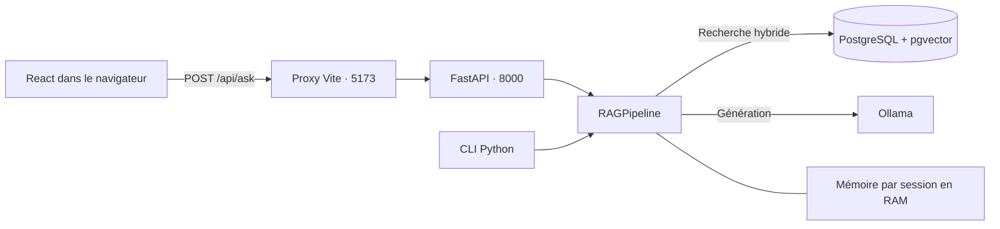

# Architecture du chat et conception de l’historique

## Fonctionnement actuel

1. [React](../web/src/main.tsx) crée un UUID pour chaque chat. La requête contient
   la question et cet UUID sous la clé `session_id`.
2. [FastAPI](../api/main.py) valide la question et appelle
   [`RAGPipeline.ask()`](../core/rag/pipeline.py). La recherche utilise la question
   seule. Le modèle reçoit le contexte documentaire et jusqu’aux cinq derniers
   messages de la session.
3. L’API renvoie la réponse et les passages retrouvés avec leur identifiant, le
   nom du fichier source et le texte de l’extrait. L’interface regroupe ces
   passages par document pour chaque réponse. Certains résultats peuvent être
   écartés du prompt par la limite de taille du contexte.
4. React garde la liste des chats dans l’onglet jusqu’à son actualisation.
   [La mémoire Python](../core/memory/conversation.py) garde les vingt derniers
   messages de chaque session, soit jusqu’à dix échanges, jusqu’à l’arrêt du
   processus. Actuellement, PostgreSQL contient le corpus et ses embeddings.

## Évolution proposée

Le premier jalon est de pouvoir rouvrir un chat avec ses questions, ses réponses
et ses passages après l’actualisation du navigateur ou le redémarrage de l’API.
PostgreSQL deviendra la source de référence des échanges pour l’interface web.

### Données à conserver

| Élément | Champs proposés | Rôle |
|---|---|---|
| `conversations` | UUID, propriétaire, titre, dates de création et de modification, version | Lister les chats du propriétaire par activité récente et contrôler les écritures concurrentes |
| `messages` | ID, conversation, position, rôle, texte, date, identifiant de requête, sources pour le rôle assistant | Rejouer les échanges dans l’ordre et reconnaître une soumission déjà enregistrée |

Chaque réponse conserve une copie des passages affichés, avec le nom du fichier
et le texte de l’extrait. Un nouveau découpage ou une réingestion du corpus
pourra modifier les identifiants des chunks en base sans affecter l’affichage
d’une ancienne conversation. Les URL et références PDF pourront enrichir ces
métadonnées lorsqu’elles seront disponibles.

La migration s’appliquera à la base existante. Chaque message référencera sa conversation et sa position sera unique
dans le chat.
Un index par propriétaire et date de modification servira à la liste des chats.

### API et interface proposées

| Appel | Comportement |
|---|---|
| `GET /api/conversations` | Charger les chats du propriétaire courant pour la barre latérale |
| `POST /api/conversations` | Créer un chat et retourner son UUID |
| `GET /api/conversations/{id}` | Charger le chat, ses messages ordonnés et leurs sources |
| `POST /api/conversations/{id}/messages` | Poser une question, enregistrer l’échange et retourner les messages créés |

Pour le jalon local, l’API attribuera les conversations à un profil local configuré
côté serveur. Pour ouvrir l’application à plusieurs personnes, l’API devra
résoudre le propriétaire depuis une identité authentifiée et vérifier son accès
pour chaque lecture et écriture. Le client transmettra l’identifiant de la
conversation. L’identité du propriétaire viendra du serveur.

### Enregistrer un échange

1. L’API lit la conversation, sa version et ses messages récents. Le pipeline
   reçoit cet historique pour construire son prompt. Le chemin web persistant
   pourra ainsi reprendre une conversation après un redémarrage.
2. Après la génération, une transaction courte vérifie la version et enregistre
   ensemble la question, la réponse, les passages et la nouvelle version. Si
   la génération échoue, l’interface laisse la question disponible pour réessayer.
3. Le client réutilise le même identifiant de requête lorsqu’il retente un envoi
   dont il ignore le résultat. Si l’échange correspondant existe déjà, l’API le
   renvoie. Si une autre requête a modifié le chat entre la lecture et l’écriture,
   l’API signale un conflit pour que le client recharge le chat avant de réessayer.

La conservation des messages et la taille de l’historique envoyé au modèle sont
deux paramètres indépendants. Le premier jalon garde le comportement actuel du
retrieval. La reformulation des questions de suivi pourra être testée ensuite
sur des échanges enregistrés comme cas d’évaluation.

### Validation du premier jalon

- Poser une question et vérifier que la conversation, la réponse et les
  extraits réapparaissent après une actualisation et un redémarrage de l’API.
- Poser une question de suivi dans le chat rouvert et vérifier que le générateur
  reçoit l’historique chargé depuis PostgreSQL.
- Simuler un échec de génération, un nouvel envoi avec le même identifiant et
  deux envois concurrents pour vérifier que les écritures restent cohérentes.
